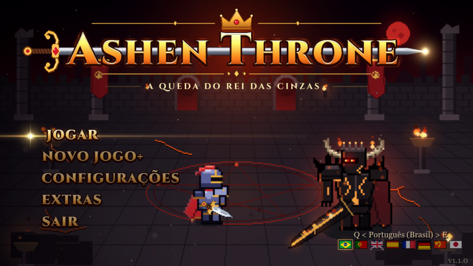
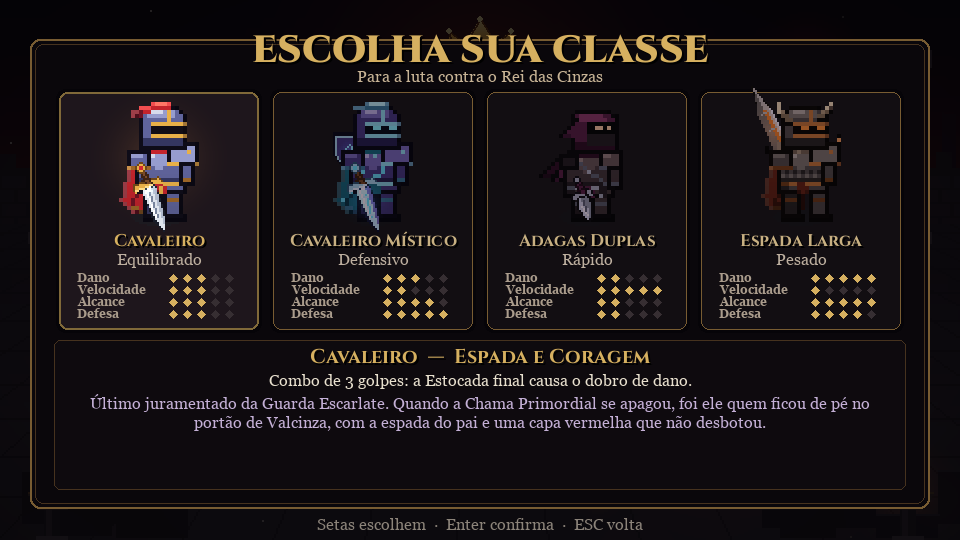
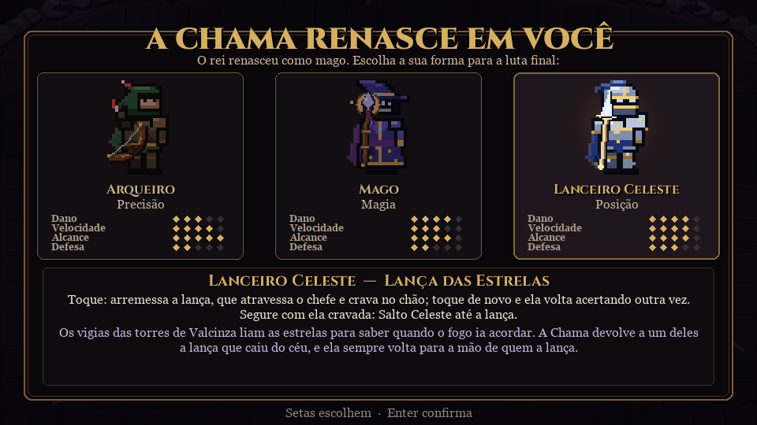
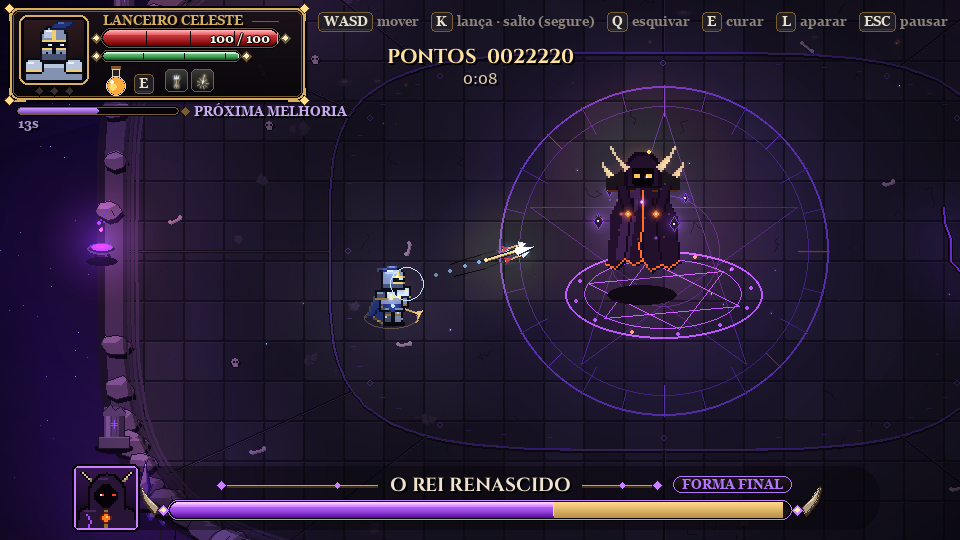
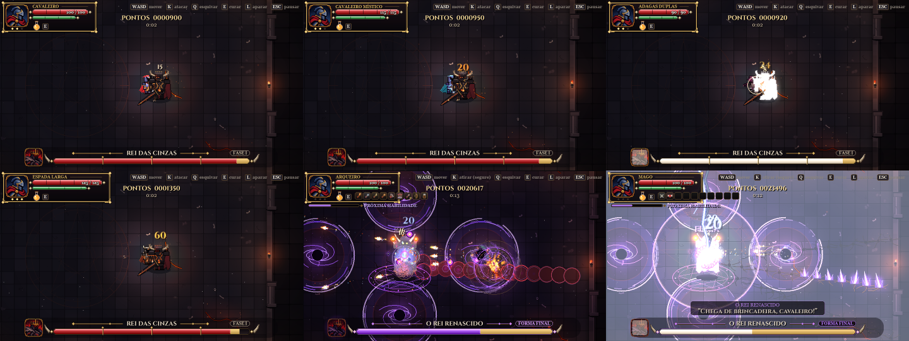

# Ashen Throne — A Queda do Rei das Cinzas

Boss rush 2D com visão de cima, no estilo souls. Escolha sua classe, leia os avisos no chão, desvie no
tempo certo e derrube o **Rei das Cinzas**. E, se ele renascer das próprias cinzas, termine o que começou.

## Baixar e jogar

1. Vá em **[Releases](../../releases)** e baixe `Instalar_AshenThrone_v1.3.0.exe`.
2. Abra o instalador e clique em **Instalar**. Não precisa de administrador (funciona em computador de escola).
3. Jogue pelo atalho **Ashen Throne** na Área de Trabalho ou no Menu Iniciar.

> O Windows pode mostrar "O Windows protegeu o computador" (o jogo não tem assinatura digital paga).
> Clique em **Mais informações** e depois em **Executar assim mesmo**.

Para remover: Configurações do Windows > Aplicativos > Ashen Throne > Desinstalar.
Os recordes ficam guardados, a não ser que você marque para apagar.

## Classes

| Classe | Estilo |
|---|---|
| **Cavaleiro** | Equilibrado: corte, corte amplo e estocada |
| **Cavaleiro Místico** | Espada e escudo arcanos: aparar fere o chefe e o 3º golpe lança uma lâmina de energia |
| **Adagas Duplas** | Muito rápido, mais crítico e menos vida |
| **Espada Larga** | Lento e devastador; o Giro Colossal acerta em volta |

Quando o rei cai, ele renasce como mago e **leva a arena para os céus**: a luta final é numa ilha de
pedra flutuando entre as estrelas. A Chama oferece a forma final: **Arqueiro** (flechas e tiro
carregado), **Mago** (bolas de energia que perseguem o alvo e, carregando, uma rajada de 4 bolas) ou
**Lanceiro Celeste** (joga a lança, que atravessa o chefe e crava no chão, puxa de volta
acertando de novo e salta até ela num rastro de luz).

## Controles

| | Teclado | Xbox | PlayStation |
|---|---|---|---|
| Mover | WASD / Setas | Analógico | Analógico |
| Atacar (segure: carregar) | K / botão esquerdo | RB, RT ou X | R1, R2 ou Quadrado |
| Esquivar | Q | B ou A | O ou × |
| Curar | E | Y | Triângulo |
| Aparar | L / botão direito | LB ou LT | L1 ou L2 |
| Pausar | ESC | Start | Options |

Não gostou de alguma tecla? Em **Configurações > Controles** dá para trocar qualquer tecla do teclado e
qualquer botão do controle.

## Novidades da 1.3.0

- **Nova classe da forma final: Lanceiro Celeste**, no lugar do Invocador (veja acima).
- **Controles personalizáveis**: troque teclas e botões em Configurações > Controles.
- **Avisos dourados** nos golpes que dá para aparar (com um escudinho em cima do rei); os vermelhos são
  só para esquivar.
- **Uma carta de melhoria a cada 25 segundos** de luta, nas duas formas, com contagem "MELHORIA EM 3, 2, 1".
- O menu principal agora muda de idioma junto com o resto do jogo.

## Idiomas

Português (Brasil e Portugal), English, Español, Français, Deutsch, 简体中文 e 日本語: clique na bandeira
no menu principal.

## Desafio

Há dois placares, um do modo normal e outro do Novo Jogo+, cada um com uma pontuação fixa, **CLD**: o
desafio (209.550 no normal e 513.450 no NG+). Passe delas! No fim de cada luta o jogo mostra um
**código de verificação** junto com os pontos, o tempo e a versão: tire uma foto dessa tela para valer.

---

© 2026 Renato Junior (Bingus Games). Todos os direitos reservados. Veja [LICENSE](LICENSE).
